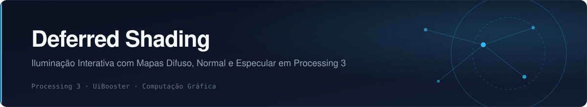
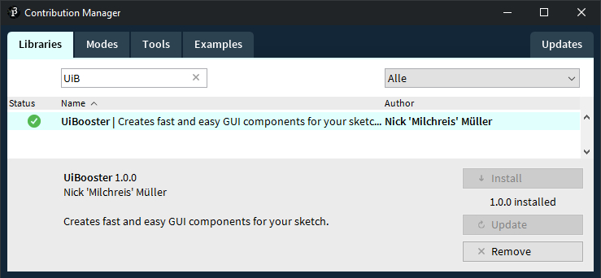

<p align="center">
  
</p>

<p align="center">
  
  
</p>

## Sobre o Projeto

Implementação interativa da técnica de **Deferred Shading** em **Processing 3**, combinando mapas de textura **difuso** (`_d`), **normal** (`_n`) e **especular** (`_s`) para calcular iluminação dinâmica em tempo real sobre personagens 2D/2.5D.

## Pré-requisitos

- **Processing 3** instalado
- Biblioteca **UiBooster** na versão **1.2.0** (instalada pelo gerenciador de bibliotecas do Processing):

<p align="center">
  
</p>

## Controles e Instruções de Uso

Abra e execute `sketch/sketch.pde` no Processing 3:

| Tecla | Ação |
| :---: | :--- |
| `i` | Alternar entre os modelos/imagens (`char1` / `char2`) |
| `s` | Alternar visualização do componente **especular** |
| `d` | Alternar visualização do componente **difuso** |
| `a` | Visualizar a **composição completa** (difuso + especular) |
| `c` | Abrir o **Color Picker** (UiBooster) para alterar a cor da luz |

## Estrutura

```text
Deferred-Shading/
├── content/
│   └── uibooster.jpg
└── sketch/
    ├── sketch.pde
    ├── char1_{d,n,s}.png
    └── char2_{d,n,s}.png
```

## Autores

- **Grupo:** `cgcc` (Charles Gabriel), `nbmcd`
